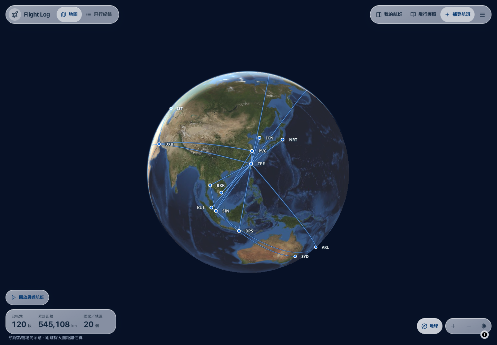
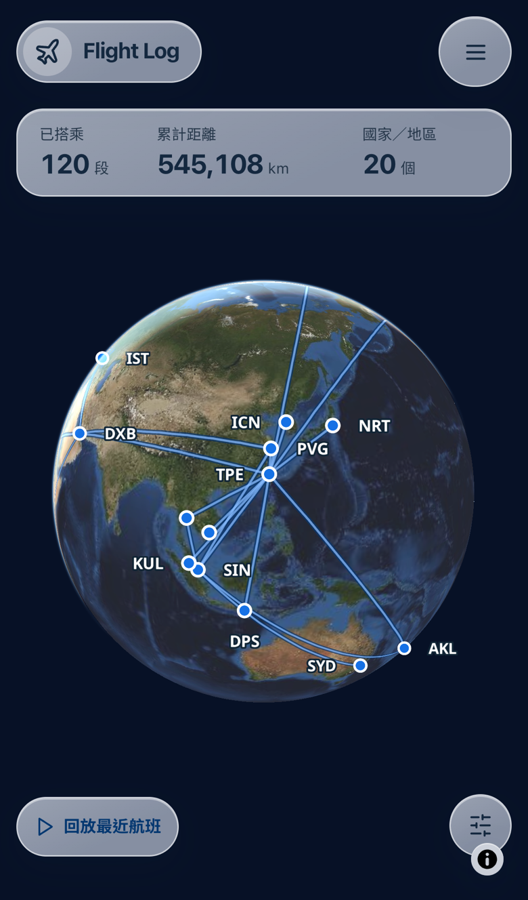
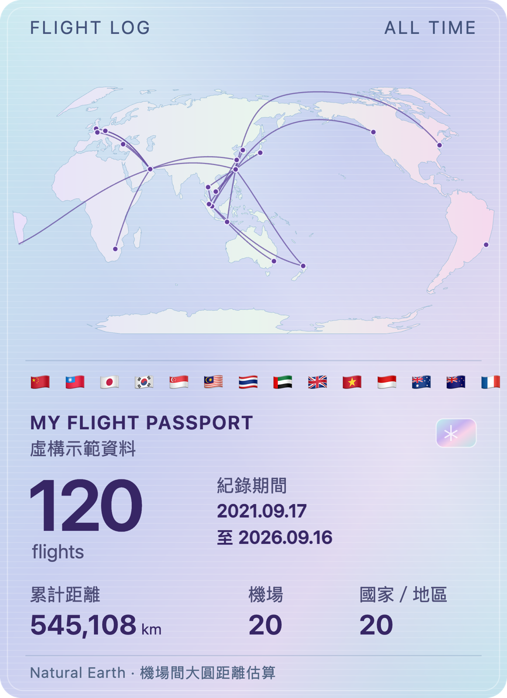
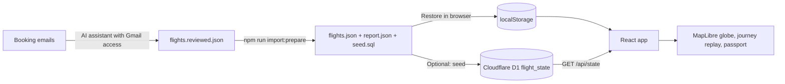

# Flight Log

Turn years of flights into a map you can replay, keep and share

**Live demo: https://flights.vibeencode.dev** · [Journey replay](https://flights.vibeencode.dev/journey/)

[Run it](#run-it) · [Self-host](docs/SELF-HOST.md) · [繁體中文](README.zh-TW.md)




Everything above is synthetic. The demo site ships 120 fictional flights, and anything you import stays in your own browser, so the demo server never sees your trips

## Why I built this

I fly a lot, and I wanted to see every flight I have ever taken on one map. Flighty does this well for trips you track from now on. My past flights were the part I cared about, and they were nowhere

The map was the easy part. The hard part was finding all the flights. Seven years of bookings sit in Trip.com and airline emails, with changes and cancellations mixed in, and no export gives you a clean list

Today that part is easy too. I ask Grok to search my Gmail and hand back every flight as JSON, then I check it and import it. So the app never needs access to your inbox. It only reads the JSON you give it

## What it does



Travel map on a globe or a flat map, with great circle routes between every airport you have flown


Journey replay that follows the aircraft, with one button cycling 1x, 2x, 4x and 8x, and a search box that takes an airport or a flight number



A passport card you can save as an image, per year or all time, with flags and distance

Also: a separate flight list where you add or correct rows, JSON backup and restore, and a demo banner that makes clear which rows are fictional

## How it works



The front end is React and TypeScript on Vite. The worker is a Cloudflare Worker with one D1 table, `flight_state`, holding a single JSON payload that is read only over HTTP. Map tiles come from OpenFreeMap and NASA GIBS, so no map API key is needed. Edits never leave the browser, which is why there is no write API and no account system

## Run it

Node 24 is required

```sh
git clone https://github.com/Hugo6991/flight-log.git
cd flight-log
nvm use
npm ci
npm run setup:local
npm start
```

Open http://127.0.0.1:4173 and you will see the 120 fictional flights. `setup:local` builds the app and creates an empty local database, and both servers listen on localhost only

## Add your own flights

1. In an AI assistant that can read your Gmail (I use Grok), paste the prompt from [docs/GMAIL-IMPORT.md](docs/GMAIL-IMPORT.md). It reads your booking emails and writes `data/local/flights.reviewed.json` in the [import format](docs/IMPORT-FORMAT.md)
2. Run `npm run import:prepare -- data/local/flights.reviewed.json`. This validates dates and airport codes, removes duplicates, flags changed or cancelled segments and strips email subjects and order ids
3. In the app, open the menu and choose restore backup, then pick the generated `flights.json`. Your flights replace the demo in this browser only

`data/local/` is ignored by git, so your records never end up in a commit

## Self-host

```sh
npx wrangler login
npx wrangler d1 create my-flight-log
# paste database_id into wrangler.jsonc, keep the binding named DB
npx wrangler d1 migrations apply my-flight-log --remote
npm run deploy
```

You get a `workers.dev` URL with an empty public source and the demo flights in the browser. Seeding D1 with your own `seed.sql` makes those flights readable by anyone with the link, so [docs/SELF-HOST.md](docs/SELF-HOST.md) walks through that decision, custom domains and backups

## Data and privacy

| Data | Where it lives | In git |
| --- | --- | --- |
| Code, airport dictionary, synthetic sample | `src`, `shared`, `public`, `data/example` | Yes |
| Your emails, orders, prices, review sheets | `data/local` | Never |
| Edits made in the app | Each browser's localStorage | No |
| Public starting flights | Your own D1 | Only if you seed it |

The 120 demo flights were generated by `scripts/generate-demo.mjs`. Flight numbers and routes have public airline sources, while every date and every flown status is invented, so the sample proves nothing about anyone's travel. See [data/example/README.md](data/example/README.md) for the full ledger

## Status

| Works today | Not here yet |
| --- | --- |
| Globe map, great circle routes, journey camera, flight list, passport image | Live flight tracking, radar tracks |
| Synthetic demo, assistant driven Gmail import, import validation | In app Gmail sign in, automatic inbox reading |
| Per browser edits, JSON backup, self hosting on Cloudflare | Accounts, cross device sync, hosted plans |

## Development

```sh
npm run check
npm test
npm run build
```

See [CONTRIBUTING.md](CONTRIBUTING.md) and [SECURITY.md](SECURITY.md), plus [THIRD_PARTY_NOTICES.md](THIRD_PARTY_NOTICES.md) for map data. Use synthetic data in issues and screenshots, and in tests

Design references: [TripTrail](https://github.com/Fangyuan025/triptrail) for journey presentation, [AirTrail](https://github.com/johanohly/AirTrail) for import docs, [Jetlog](https://github.com/pbogre/jetlog) for self hosting and privacy notes. No code was copied from them. Flighty is a visual reference only and is not affiliated

MIT License. It covers the original code and the synthetic sample, not your emails, your travel records, airline source pages, map services or third party brands

Built by one person with a team of agents. Product and design decisions are mine; agents write the code and I review what ships
